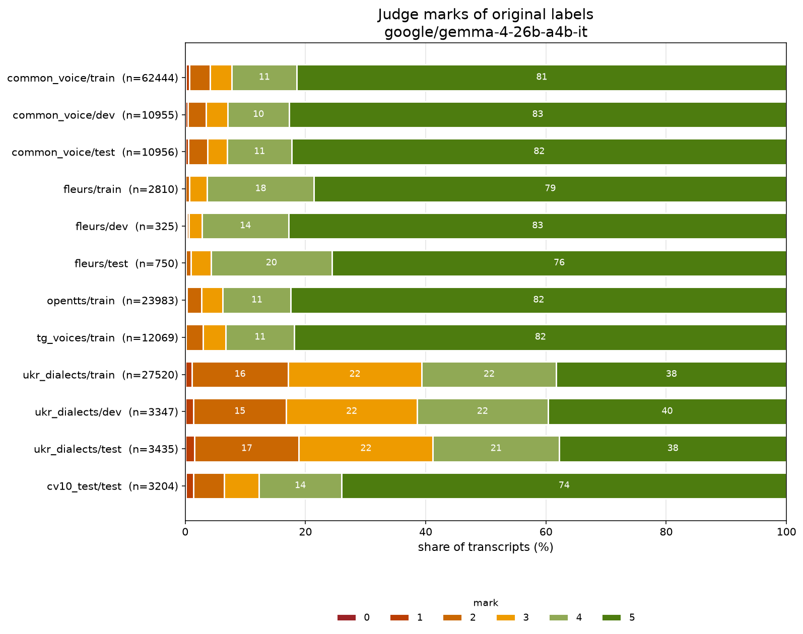
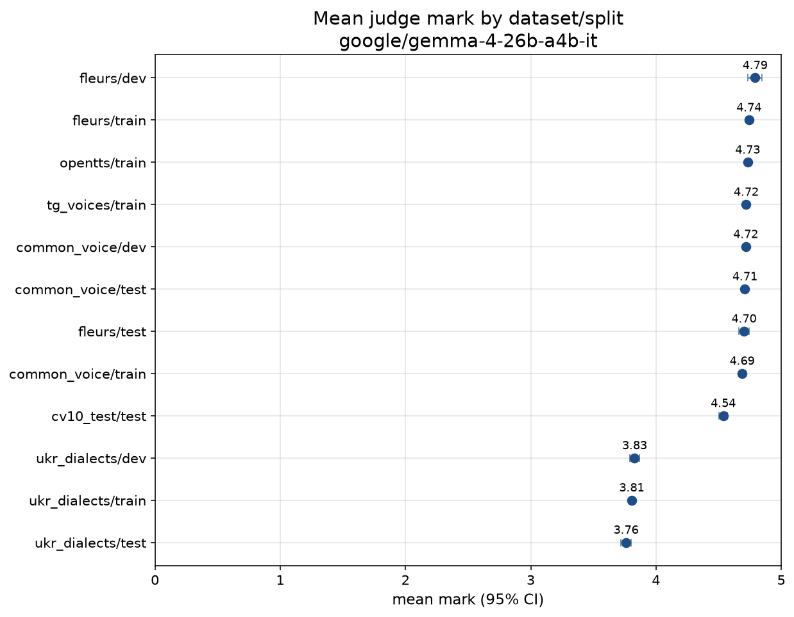
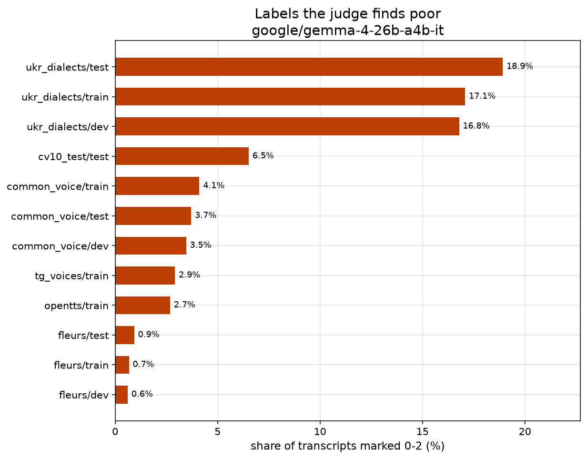

# Judge marks of original labels — google/gemma-4-26b-a4b-it

- judge model: `google/gemma-4-26b-a4b-it` (backend `llm`)
- started: 2026-11-08T12:45:43, report: 2026-11-08T19:12:14
- prompt: `pseudo-labelling/llm-as-a-judge/prompt.txt` (sha256 `46d5132211c4`)
- sample: all transcripts
- marked: 161798 of 161814 sampled transcripts

Marks: 0 nonsense · 1 mostly broken · 2 many errors · 3 several errors · 4 minor errors · 5 sound label.

## Summary

| dataset/split | population | marked | mean ± 95% CI | % 0 | % 1 | % 2 | % 3 | % 4 | % 5 | % 4-5 | % 0-2 |
|---|---:|---:|---:|---:|---:|---:|---:|---:|---:|---:|---:|
| common_voice/train | 62460 | 62444 | 4.69 ± 0.01 | 0.1 | 0.6 | 3.4 | 3.6 | 10.9 | 81.4 | 92.3 | 4.1 |
| common_voice/dev | 10955 | 10955 | 4.72 ± 0.01 | 0.1 | 0.4 | 3.0 | 3.6 | 10.2 | 82.7 | 92.9 | 3.5 |
| common_voice/test | 10956 | 10956 | 4.71 ± 0.01 | 0.0 | 0.5 | 3.1 | 3.2 | 10.8 | 82.3 | 93.0 | 3.7 |
| fleurs/train | 2810 | 2810 | 4.74 ± 0.02 | 0.0 | 0.1 | 0.6 | 3.0 | 17.8 | 78.6 | 96.3 | 0.7 |
| fleurs/dev | 325 | 325 | 4.79 ± 0.06 | 0.0 | 0.3 | 0.3 | 2.2 | 14.5 | 82.8 | 97.2 | 0.6 |
| fleurs/test | 750 | 750 | 4.70 ± 0.04 | 0.0 | 0.1 | 0.8 | 3.3 | 20.1 | 75.6 | 95.7 | 0.9 |
| opentts/train | 23983 | 23983 | 4.73 ± 0.01 | 0.0 | 0.2 | 2.4 | 3.6 | 11.3 | 82.4 | 93.7 | 2.7 |
| tg_voices/train | 12069 | 12069 | 4.72 ± 0.01 | 0.0 | 0.1 | 2.8 | 3.8 | 11.4 | 81.8 | 93.3 | 2.9 |
| ukr_dialects/train | 27520 | 27520 | 3.81 ± 0.01 | 0.1 | 1.1 | 15.9 | 22.3 | 22.4 | 38.3 | 60.6 | 17.1 |
| ukr_dialects/dev | 3347 | 3347 | 3.83 ± 0.04 | 0.0 | 1.3 | 15.4 | 21.8 | 21.8 | 39.7 | 61.4 | 16.8 |
| ukr_dialects/test | 3435 | 3435 | 3.76 ± 0.04 | 0.1 | 1.5 | 17.4 | 22.3 | 21.0 | 37.8 | 58.8 | 18.9 |
| cv10_test/test | 3204 | 3204 | 4.54 ± 0.03 | 0.1 | 1.3 | 5.1 | 5.7 | 13.8 | 74.0 | 87.8 | 6.5 |

## Plots

## Lowest-marked examples

### common_voice/train

- **0** — Три крапки
- **0** — мурома, меря, весь, мокша, мещера
- **0** — Гутан Н.
- **0** — ни по той дуб миля
- **0** — Тень, тень, аби минув день.

### common_voice/dev

- **0** — Савченко В.
- **0** — ґ
- **0** — Клейноди, животи, обнови.
- **0** — Вітсен Н.
- **0** — — Такти той.

### common_voice/test

- **0** — меря, мурома, весь, мещера, перм, печора, мокша, мордва, марі
- **0** — Годой крізь зуби проказав:
- **0** — Палдо А.
- **0** — Тире
- **0** — ни по той дуб миля

### fleurs/train

- **1** — вьоджин купили лише гарний банк нозен рок не трастову компанію
- **1** — вьоджин купили лише гарний банк нозен рок не трастову компанію
- **2** — деяких нібито вирощували тварини казали що дехто жив у дикій природі самотужки
- **2** — вьоджин купили лише гарний банк нозен рок не трастову компанію
- **2** — виборче законодавство франції досить вимогливо шифрує провадження

### fleurs/dev

- **1** — потім лаккха сінг взяв на себе ініціативу у співі бгаджан
- **2** — є багато пляжів завдяки розташуванню окленда між двома гаванями найбільш популярні знаходяться у трьох районах
- **3** — потім лаккха сінг взяв на себе ініціативу у співі бгаджан
- **3** — інтригуючим селом варто прогулятися хоча б півгодини
- **3** — це п'ята тимчасова виборча рада мартеллі за чотири роки

### fleurs/test

- **1** — лакха сінгх так само презентував чхаппан бхог бхайан співак райю хандельвал йому акомпанував
- **2** — люди тепер пишуть повідомлення на екрані комп'ютера не маючи жодної необхідності наближатися до стругачки
- **2** — відбивачі середнього порядку сачин тендулкар та рауль дравід зіграли добре на пару виконавши сотню пробігів
- **2** — фотографи пізніше зайняли місце літньої пані бо їй знадобилося в туалет мендозу застрелили
- **2** — лакха сінгх так само презентував чхаппан бхог бхайан співак райю хандельвал йому акомпанував

### opentts/train

- **0** — — Мне отмщение, и аз воздам, — сказав господь.
- **0** — — Кре, кре, кре, кре, кре, кре!
- **0** — — Мне отмщение, и аз воздам, — сказав господь.
- **0** — — Кре, кре, кре, кре, кре, кре!
- **0** — — Сто люїдорів.

### tg_voices/train

- **0** — — Мне отмщение, и аз воздам, — сказав господь.
- **0** — — Кре, кре, кре, кре, кре, кре!
- **0** — — Кре, кре, кре, кре, кре, кре!
- **1** — Треба матись на бачності.
- **1** — От і давай уже хоть коло сього леститись.

### ukr_dialects/train

- **0** — Урали, ґанті-ванті Урали.
- **0** — Реком рези раняні рвуться руна віке.
- **0** — Ракви різблене рам'є ранять руки рокі.
- **0** — Срібний свест стєс у суслі, сне святочно схіляних смерік.
- **0** — І цяо клягу даю.

### ukr_dialects/dev

- **0** — Ади — вно гезде.
- **1** — А то скобомйот.
- **1** — Клябученрики, а там є Голови, то головці.
- **1** — Та й три-- дві дівчинці над одним ми з головою.
- **1** — І це зачинилось, як ті підівилися, у кого ще задні нівітко, що якась торбинка є чи якась блюдце, чи що?

### ukr_dialects/test

- **0** — Ну коби ж бо навкірки з меживаску трус возму, аби хаутуре їла, Гнаткащину вала.
- **0** — Лиш ни фалітси сараки, бо нима куда.
- **1** — О, я дитину вночі робив, щоби тото, що ніхто не чув.
- **1** — І він втік уже, і він в Франківськ, і з того серця батїв бастигнили.
- **1** — А то на, на спомині.

### cv10_test/test

- **0** — один дражнився битіасом
- **0** — спи
- **0** — ни по той дуб миля
- **0** — підкинула як зозуля під плиску
- **1** — речи як серце тобі велить княже годоє
