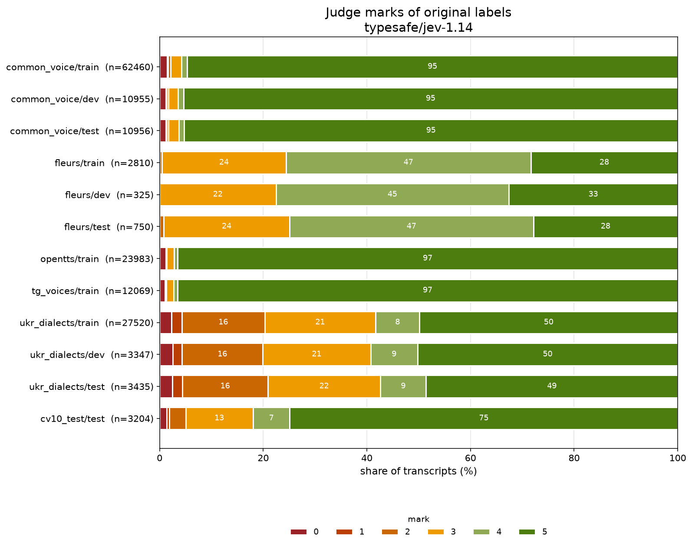
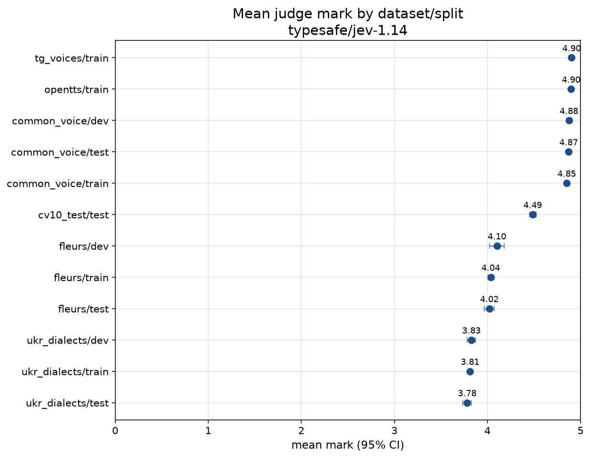
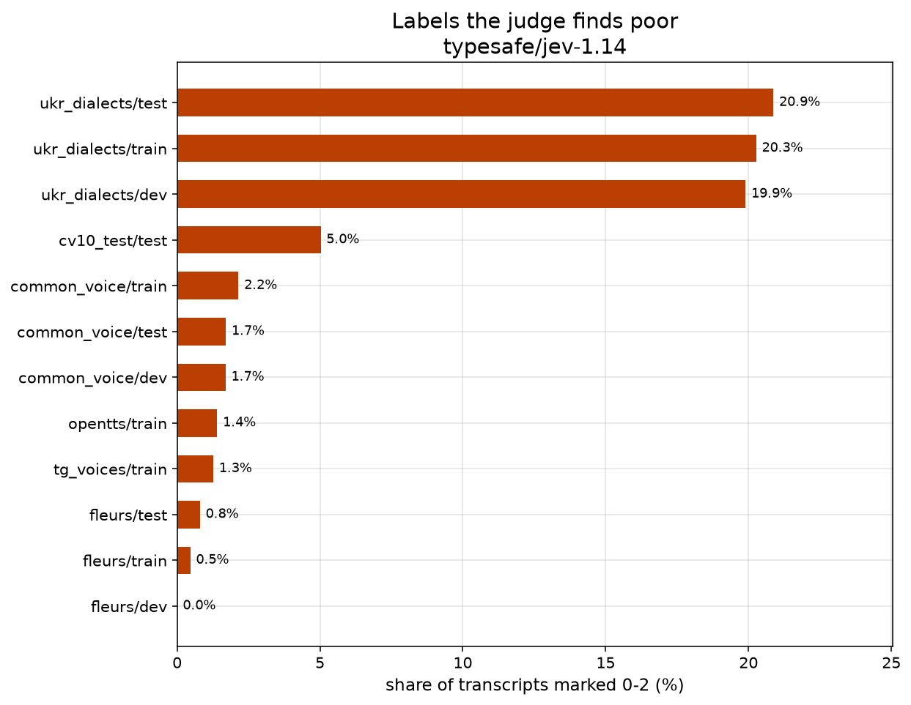

# Judge marks of original labels — typesafe/jev-1.14

- judge model: `typesafe/jev-1.14` (backend `decisions`)
- started: 2026-11-08T19:14:03, report: 2026-11-08T19:26:57
- prompt: `pseudo-labelling/llm-as-a-judge/prompt.txt` (sha256 `46d5132211c4`)
- sample: all transcripts
- marked: 161814 of 161814 sampled transcripts

Marks: 0 nonsense · 1 mostly broken · 2 many errors · 3 several errors · 4 minor errors · 5 sound label.

Decision backend: the mark is the most probable level; *score* is the probability-weighted level (0-5) and *confidence* is how concentrated the probabilities are.

## Summary

| dataset/split | population | marked | mean ± 95% CI | % 0 | % 1 | % 2 | % 3 | % 4 | % 5 | % 4-5 | % 0-2 | mean score | mean confidence |
|---|---:|---:|---:|---:|---:|---:|---:|---:|---:|---:|---:|---:|---:|
| common_voice/train | 62460 | 62460 | 4.85 ± 0.01 | 1.5 | 0.2 | 0.5 | 2.1 | 1.1 | 94.7 | 95.8 | 2.2 | 4.42 | 0.66 |
| common_voice/dev | 10955 | 10955 | 4.88 ± 0.01 | 1.2 | 0.1 | 0.3 | 1.9 | 1.0 | 95.4 | 96.4 | 1.7 | 4.45 | 0.68 |
| common_voice/test | 10956 | 10956 | 4.87 ± 0.01 | 1.2 | 0.1 | 0.3 | 2.0 | 1.0 | 95.3 | 96.3 | 1.7 | 4.43 | 0.67 |
| fleurs/train | 2810 | 2810 | 4.04 ± 0.03 | 0.0 | 0.0 | 0.5 | 23.9 | 47.3 | 28.4 | 75.6 | 0.5 | 3.81 | 0.56 |
| fleurs/dev | 325 | 325 | 4.10 ± 0.08 | 0.0 | 0.0 | 0.0 | 22.5 | 44.9 | 32.6 | 77.5 | 0.0 | 3.84 | 0.57 |
| fleurs/test | 750 | 750 | 4.02 ± 0.05 | 0.0 | 0.0 | 0.8 | 24.3 | 47.1 | 27.9 | 74.9 | 0.8 | 3.79 | 0.56 |
| opentts/train | 23983 | 23983 | 4.90 ± 0.01 | 1.2 | 0.1 | 0.1 | 1.4 | 0.7 | 96.5 | 97.2 | 1.4 | 4.52 | 0.72 |
| tg_voices/train | 12069 | 12069 | 4.90 ± 0.01 | 1.0 | 0.1 | 0.2 | 1.5 | 0.7 | 96.6 | 97.2 | 1.3 | 4.51 | 0.71 |
| ukr_dialects/train | 27520 | 27520 | 3.81 ± 0.02 | 2.3 | 2.0 | 16.0 | 21.4 | 8.5 | 49.8 | 58.3 | 20.3 | 3.58 | 0.47 |
| ukr_dialects/dev | 3347 | 3347 | 3.83 ± 0.05 | 2.5 | 1.8 | 15.6 | 20.8 | 9.1 | 50.2 | 59.3 | 19.9 | 3.58 | 0.47 |
| ukr_dialects/test | 3435 | 3435 | 3.78 ± 0.05 | 2.5 | 2.0 | 16.4 | 21.7 | 8.8 | 48.6 | 57.4 | 20.9 | 3.56 | 0.47 |
| cv10_test/test | 3204 | 3204 | 4.49 ± 0.04 | 1.3 | 0.6 | 3.1 | 13.0 | 7.1 | 74.9 | 82.0 | 5.0 | 4.02 | 0.51 |

## Plots

## Lowest-marked examples

### common_voice/train

- **0** — Перемелеться лихо — добро буде.
- **0** — — Душу твою, Великий княже.
- **0** — — Сестра.
- **0** — На чужий коровай рота не роззявляй.
- **0** — — З Городища?

### common_voice/dev

- **0** — А вам не покорюсь.
- **0** — То все троянськая станиця
- **0** — — Кто у вас там верховодіт в сьолах? Какоє аружиє імєєтє? Сколька?
- **0** — І стали тута оддихать.
- **0** — Грудачев П.

### common_voice/test

- **0** — Я не даю людям команди.
- **0** — землянку.
- **0** — — Корити-ймуся.
- **0** — Я тут недалеко живу.
- **0** — Зайця ноги носять, вовка зуби годують.

### fleurs/train

- **2** — ел гор і генерал томмі френкс мимохідь випалюють свої улюблені заголовки улюбленим заголовком гора був той коли зе оніон повідомив що ел і тіппер займалися кращим у своєму житті сексом після його поразки в колегії виборців у 2000 році
- **2** — деяких нібито вирощували тварини казали що дехто жив у дикій природі самотужки
- **2** — поняття кави флет-вайт є незнайомим для австралійців. шорт блек – це еспресо капучино готують із гіркою вершків не з піною а чай подається без молока
- **2** — туристичні поїздки затратні вимагають хорошої фізичної форми можуть відбуватися лише влітку з листопада по лютий і здебільшого обмежуються півостровом островами та морем росса
- **2** — часто доводиться окремо купувати міжнародний номер який дозволяє тмзк-телефонам дзвонити вам те звідки номер має велике значення для тих хто вам телефонує

### fleurs/dev

- **3** — для баба шиам було подано 108 тарілок виробника схапхан бхог в індуїзмі 56 різних їстівних речей наприклад солодощів фруктів оріхів страв тощо які пропонуються божеству
- **3** — більшість районів обслуговуються маленькими японськими автобусами костер які є комфортними і міцними
- **3** — головна мета науки дізнатися науковими методами як працює світ цей метод дійсно керує більшістю наукових досліджень
- **3** — його всюдисуща сила мала вплив на всіх від короля до простолюдина
- **3** — арлі веласкес з мексики фінішував п'ятнадцятим в чоловічому сидячому заїзді з супергігантського слалому новозеландський спортсмен адам холл фінішував дев'ятим в чоловічому стоячому заїзді з супергігантського слалому

### fleurs/test

- **2** — фотографи пізніше зайняли місце літньої пані бо їй знадобилося в туалет мендозу застрелили
- **2** — лакха сінгх так само презентував чхаппан бхог бхайан співак райю хандельвал йому акомпанував
- **2** — зазвичай ви завжди чуєте звуки туристів і торговців історія звуку та світла як збірка оповідань
- **2** — зазвичай ви завжди чуєте звуки туристів і торговців історія звуку та світла як збірка оповідань
- **2** — фотографи пізніше зайняли місце літньої пані бо їй знадобилося в туалет мендозу застрелили

### opentts/train

- **0** — Я вдова бусурмана.
- **0** — Господь не попустить такого злочину.
- **0** — Прощай, пане князю.
- **0** — А на столику вся холодна кухня.
- **0** — Джекоб плюхнув на землю.

### tg_voices/train

- **0** — В темну могилу.
- **0** — — Мне отмщение, и аз воздам, — сказав господь.
- **0** — — Констансія Бонасьє.
- **0** — — Наш брат не у всякі двері й сунься.
- **0** — — Ах, монсеньєр!

### ukr_dialects/train

- **0** — Дзьобня, дзьобня, тайстра, капчури, хустина, бесаги.
- **0** — Бог би ті карао, ферма ти!
- **0** — Ну, не знаю.
- **0** — Бартка добра мосяжна, ліпша.
- **0** — Ну, то старе.

### ukr_dialects/dev

- **0** — Чєлік не пускали на полонину.
- **0** — Кубік дерева на місці коштував один злотик, а вивезти його на Попіван коштувало дванадцять злотиків.
- **0** — Ну, на зиму сердак, ну.
- **0** — Ну, там океан уже такий.
- **0** — То й куда я заработав?

### ukr_dialects/test

- **0** — От, е, так.
- **0** — Я думаю, там- Ти не хочеш, а тебе тягне туди йти?
- **0** — Ну, не знаю.
- **0** — Тай до того...
- **0** — Так, отакими ручками.

### cv10_test/test

- **0** — з городу стольного з витичева
- **0** — перемелеться лихо добро буде
- **0** — всяка жертва нечестивих бридка перед богом
- **0** — завес допустить посадить
- **0** — перемелеться лихо добро буде
