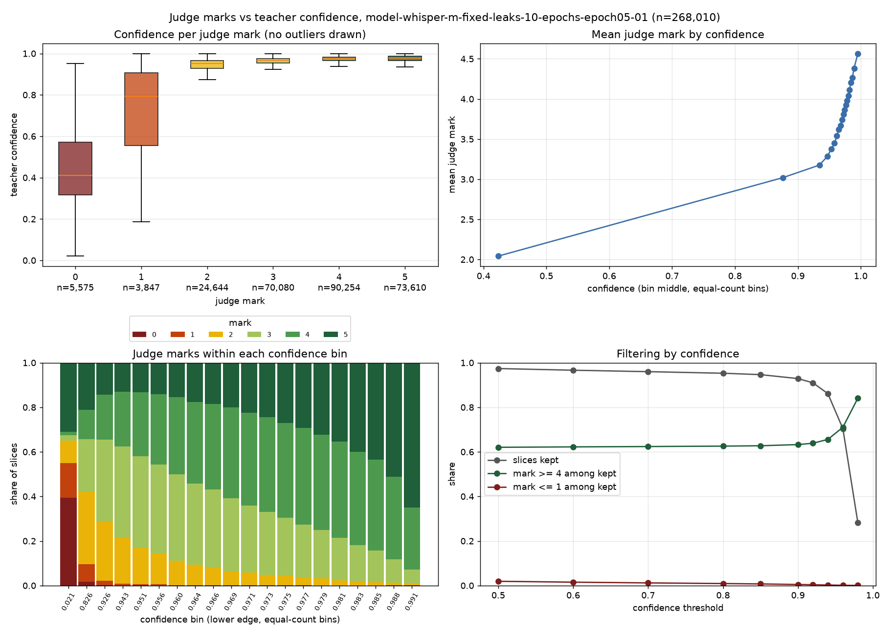

# Judge marks vs teacher confidence: model-whisper-m-fixed-leaks-10-epochs-epoch05-01

Generated 2026-11-26 16:16 by `pseudo-labelling/confidences/judge_vs_confidence.py`.

1. Marks: `output/pseudo-labelling/model-whisper-m-fixed-leaks-10-epochs-epoch05-01/label_marks.csv` (351,840 valid marks).
2. Confidence: `output/pseudo-labelling/model-whisper-m-fixed-leaks-10-epochs-epoch05-02/labels.csv`.
3. Joined on ID: 351,840; same text: 268,010; used: 268,010. Different runs: only slices with identical text in both runs are kept.

## Correlation with the mark

AUROC mark>=4: how well a higher value separates marks 4-5 from the rest. AUROC mark<=1: how well a lower value finds marks 0-1. 0.5 is chance.

| field | spearman | pearson | auroc mark>=4 | auroc mark<=1 |
|---|---|---|---|---|
| confidence | 0.417 | 0.411 | 0.728 | 0.968 |
| avg_logprob | 0.417 | 0.381 | 0.728 | 0.968 |
| min_logprob | 0.369 | 0.392 | 0.689 | 0.812 |
| num_tokens | -0.099 | 0.038 | 0.466 | 0.934 |
| compression_ratio | -0.081 | 0.162 | 0.478 | 0.929 |
| truncated | -0.005 | -0.007 | 0.500 | 0.500 |

## Confidence per mark

| mark | count | mean | 10% | 25% | median | 75% |
|---|---|---|---|---|---|---|
| 0 | 5,575 | 0.450 | 0.225 | 0.317 | 0.411 | 0.571 |
| 1 | 3,847 | 0.729 | 0.417 | 0.555 | 0.794 | 0.907 |
| 2 | 24,644 | 0.927 | 0.886 | 0.929 | 0.952 | 0.966 |
| 3 | 70,080 | 0.962 | 0.940 | 0.955 | 0.967 | 0.976 |
| 4 | 90,254 | 0.971 | 0.953 | 0.965 | 0.975 | 0.982 |
| 5 | 73,610 | 0.950 | 0.930 | 0.966 | 0.979 | 0.987 |

## Marks per confidence bin (20 equal-count bins)

| low | high | slices | mean_mark | mark 0 | mark 1 | mark 2 | mark 3 | mark 4 | mark 5 |
|---|---|---|---|---|---|---|---|---|---|
| 0.021 | 0.826 | 13,401 | 2.042 | 0.393 | 0.157 | 0.101 | 0.023 | 0.016 | 0.310 |
| 0.826 | 0.926 | 13,403 | 3.020 | 0.017 | 0.078 | 0.326 | 0.237 | 0.131 | 0.211 |
| 0.926 | 0.943 | 13,411 | 3.176 | 0.001 | 0.020 | 0.268 | 0.365 | 0.203 | 0.143 |
| 0.943 | 0.951 | 13,397 | 3.283 | 0.001 | 0.008 | 0.205 | 0.410 | 0.244 | 0.131 |
| 0.951 | 0.956 | 13,426 | 3.379 | 0.001 | 0.005 | 0.163 | 0.411 | 0.287 | 0.133 |
| 0.956 | 0.960 | 13,378 | 3.449 | 0.001 | 0.005 | 0.139 | 0.399 | 0.316 | 0.141 |
| 0.960 | 0.964 | 13,391 | 3.541 | 0.000 | 0.002 | 0.109 | 0.387 | 0.347 | 0.154 |
| 0.964 | 0.966 | 13,397 | 3.620 | 0.001 | 0.002 | 0.092 | 0.363 | 0.366 | 0.176 |
| 0.966 | 0.969 | 13,407 | 3.669 | 0.000 | 0.002 | 0.081 | 0.348 | 0.382 | 0.186 |
| 0.969 | 0.971 | 13,432 | 3.743 | 0.000 | 0.001 | 0.062 | 0.329 | 0.408 | 0.200 |
| 0.971 | 0.973 | 13,398 | 3.806 | 0.000 | 0.001 | 0.057 | 0.300 | 0.416 | 0.226 |
| 0.973 | 0.975 | 13,410 | 3.863 | 0.000 | 0.001 | 0.047 | 0.282 | 0.426 | 0.244 |
| 0.975 | 0.977 | 13,382 | 3.923 | 0.000 | 0.001 | 0.042 | 0.260 | 0.426 | 0.270 |
| 0.977 | 0.979 | 13,374 | 3.981 | 0.000 | 0.001 | 0.036 | 0.238 | 0.434 | 0.292 |
| 0.979 | 0.981 | 13,428 | 4.039 | 0.000 | 0.000 | 0.032 | 0.217 | 0.427 | 0.323 |
| 0.981 | 0.983 | 13,418 | 4.115 | 0.000 | 0.000 | 0.023 | 0.190 | 0.433 | 0.353 |
| 0.983 | 0.985 | 13,398 | 4.202 | 0.000 | 0.000 | 0.017 | 0.163 | 0.418 | 0.401 |
| 0.985 | 0.988 | 13,384 | 4.264 | 0.000 | 0.000 | 0.015 | 0.141 | 0.408 | 0.436 |
| 0.988 | 0.991 | 13,403 | 4.382 | 0.000 | 0.001 | 0.011 | 0.104 | 0.370 | 0.513 |
| 0.991 | 1.000 | 13,372 | 4.566 | 0.000 | 0.000 | 0.010 | 0.062 | 0.277 | 0.650 |

## Filtering by a confidence threshold

| confidence >= | kept | mean mark | mark>=4 | mark<=1 |
|---|---|---|---|---|
| 0.500 | 0.974 | 3.757 | 0.620 | 0.019 |
| 0.600 | 0.966 | 3.769 | 0.622 | 0.015 |
| 0.700 | 0.960 | 3.778 | 0.624 | 0.012 |
| 0.800 | 0.953 | 3.787 | 0.626 | 0.009 |
| 0.850 | 0.947 | 3.794 | 0.627 | 0.007 |
| 0.900 | 0.929 | 3.809 | 0.633 | 0.005 |
| 0.920 | 0.910 | 3.825 | 0.639 | 0.004 |
| 0.940 | 0.861 | 3.864 | 0.656 | 0.002 |
| 0.960 | 0.704 | 3.977 | 0.710 | 0.001 |
| 0.980 | 0.281 | 4.277 | 0.841 | 0.001 |

